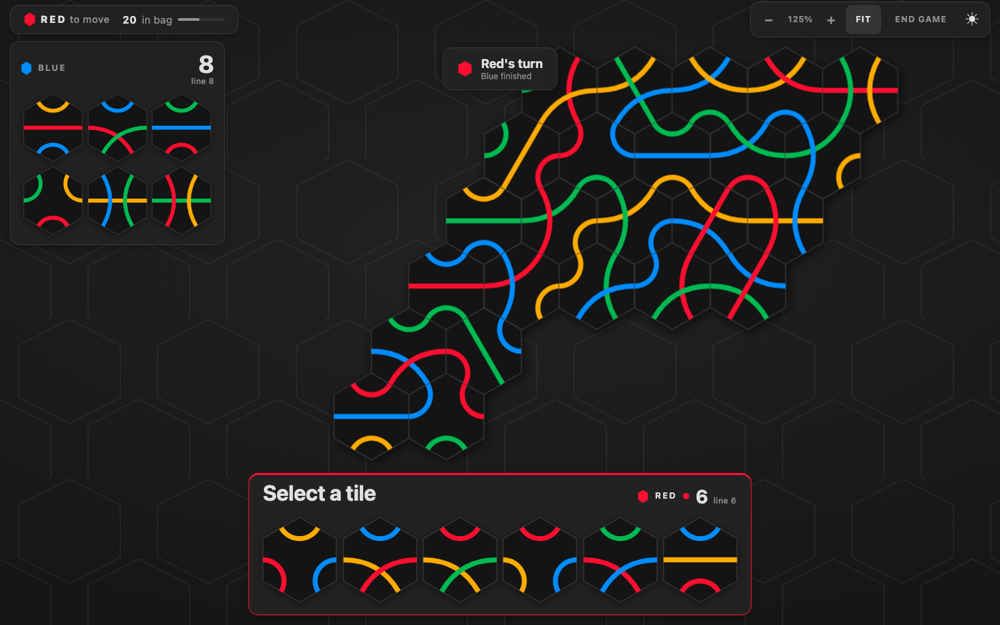
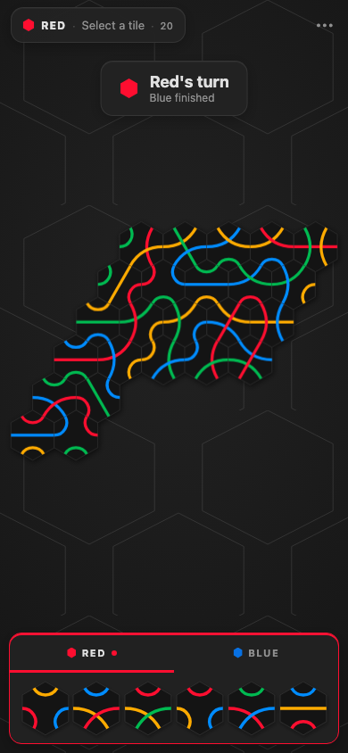
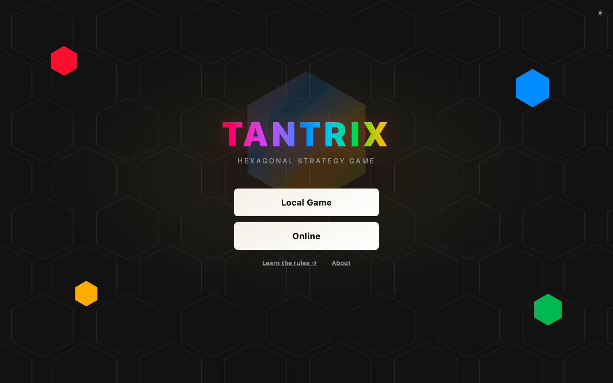

[Play](https://tantrix.louis-dispa.fr) · [Downloads](https://tantrix.louis-dispa.fr/download) · [Releases](https://github.com/LouisDISPA/tantrix-game/releases)

**Tantrix** is a tabletop game where you compete for the longest line or loop.

This is small side project, unofficial and not affiliated with Tantrix.

<details>
<summary>Screenshots</summary>

<p>
  
  
</p>



</details>

## Architecture

The game engine is independent of the interface and server. The web app, desktop app, terminal game and AI tournament use the same rules and scoring.

| Layer | Technology |
| --- | --- |
| Application | Rust nightly, Dioxus 0.7 |
| Browser | WebAssembly, SSR + hydration |
| Graphics | SVG tiles and paths, responsive CSS |
| Native backend | Axum, Tokio, SQLite |
| Cloudflare backend | Workers, Durable Objects |
| Multiplayer | WebSockets, JSON messages, shared room engine |
| Terminal | Ratatui, Crossterm |

The UI sends move requests to an authoritative room server. The shared room engine validates actions and produces state changes and socket effects; each backend handles its own storage and delivery. Local games run directly through the core engine.

## Workspace

| Crate | Role |
| --- | --- |
| `tantrix-app` | Main UI and native fullstack server |
| `tantrix-game` | Tiles, legal moves, turns, scoring, history, undo/replay |
| `tantrix-ai` | Greedy, strategic, lookahead and Monte Carlo players |
| `tantrix-tui` | Interactive terminal game |
| `tantrix-tournament` | Configurable AI round robin, TUI/headless modes |
| `tantrix-room` | Room orchestration shared by both backends |
| `tantrix-proto` | Client/server message types |
| `tantrix-net` | Browser and native WebSocket clients |
| `tantrix-worker` | Cloudflare SSR and room Durable Object |

Seeded local games and tournaments are reproducible. The app exposes four AI difficulties; the tournament accepts TOML configurations for strategies and parameters. [AI details](doc/ai.md).

## Development

Install Rust through rustup, `just`, and Dioxus CLI **0.7.10**. The checked-in toolchain selects nightly, rustfmt, Clippy and the Wasm target. Node.js and pnpm are used for Worker tooling and browser tests. [Setup instructions](doc/development.md).

```sh
just dev                         # Web app + native backend
just desktop                     # Desktop app
cargo run -p tantrix-tui          # Terminal game
```

Run a tournament:

```sh
cargo run --release -p tantrix-tournament -- \
  --config tantrix-tournament/configs/championship.toml --headless
```

## Verification

Rust tests cover game rules, scoring, room behavior and application state. Playwright checks browser flows against either backend.

```sh
just fmt-check
just lint
just test
just native-e2e                  # Axum browser tests
just worker-e2e                  # Worker browser tests
```

[Game engine](doc/game.md) · [Worker setup](cloudflare/README.md) · [Browser tests](e2e/README.md)

## AI Disclaimer

This project use a lot of AI tools for it's development.
