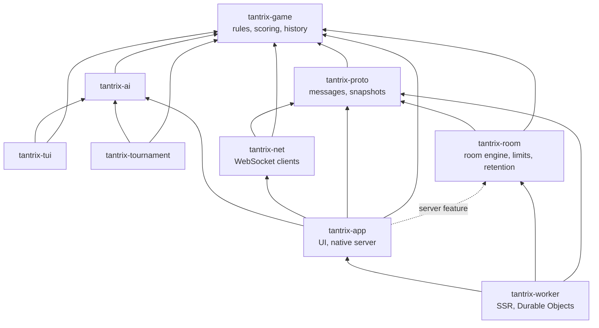
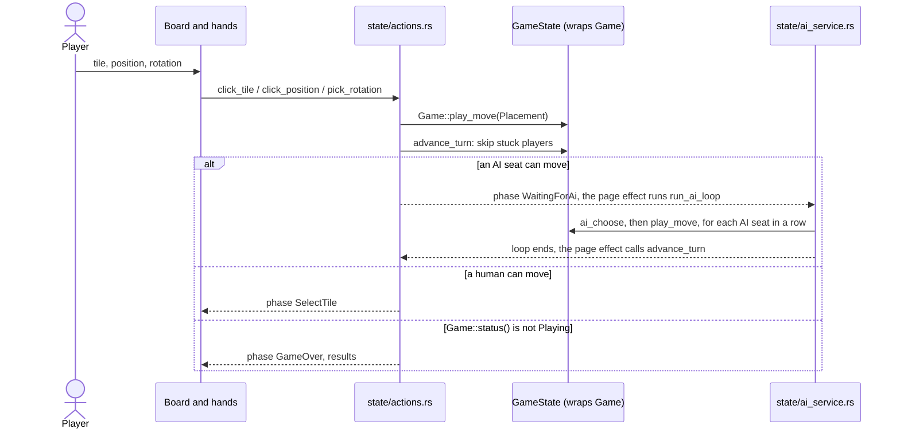
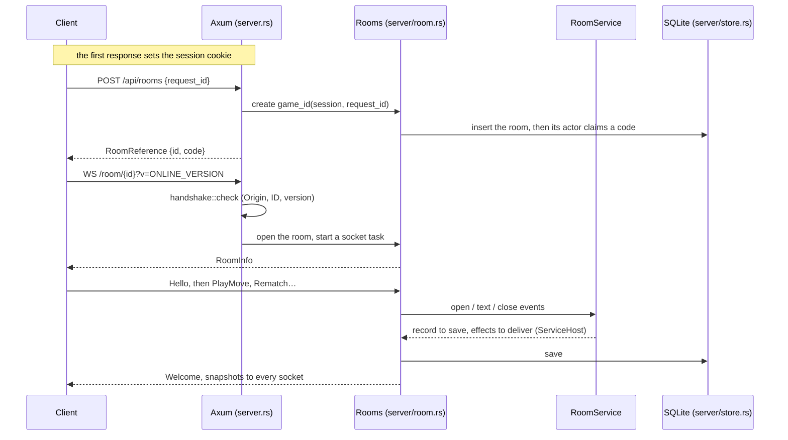
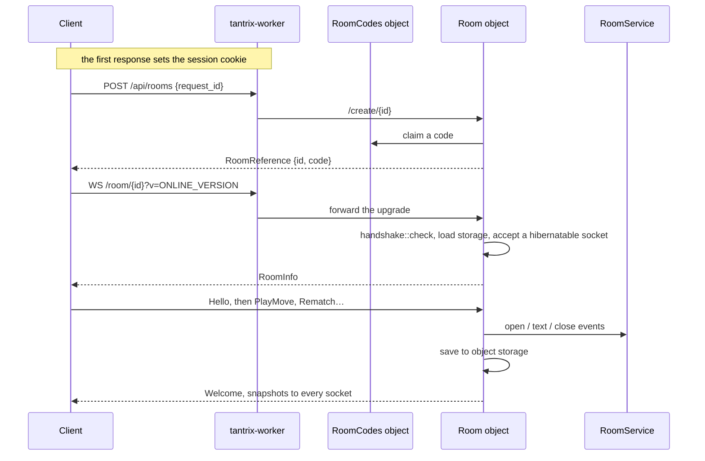
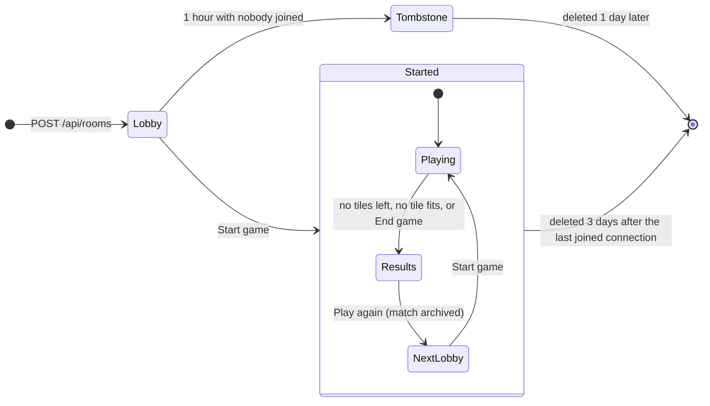

# Architecture

How the crates fit together and how a game flows through them. Details live
in the domain docs: [engine](game.md), [AI](ai.md),
[multiplayer](MULTIPLAYER.md), [components](components.md),
[state](signals.md) and [Worker](../cloudflare/README.md).

## Crates

Arrows point at direct dependencies.

`tantrix-game` has no I/O and no UI. `tantrix-app` is one Dioxus crate built
several ways; platform code is gated with the `cfg` aliases in
`tantrix-app/build.rs`:

| Build | Features | Alias |
| --- | --- | --- |
| Browser client (wasm32) | `web`; `fullstack` for hydration | `web_client` |
| Native server, binary `tantrix` | `server` (`dx` adds it to fullstack builds) | |
| Desktop app | `desktop`; `bundle` for packages | `native_client`, `native_io` |
| Android app | `android` (uses `mobile`) | `native_client`, `native_io` on Android |
| Worker SSR | `worker`, compiled by `tantrix-worker` | |

## Local game

Every seat plays on this device (`GameDriver::Local`).

## Online rooms

Online play uses the same game screens with `GameDriver::Online`: the client
sends intents and mirrors the snapshots the room sends back. The client side
is the same for both servers:

- `state/room_api.rs` creates rooms and resolves codes over HTTP;
  `state/server_endpoints.rs` picks the server (the page's origin, a build's
  `TANTRIX_ROOM_URL`, or the native apps' saved address).
- `pages/online/driver.rs` owns one socket at a time and reconnects with
  jittered backoff (`state/online_state/recovery.rs`); `tantrix-net` carries
  the frames and keepalives.
- `hooks/online_game.rs` turns each snapshot into `GameState` and UI changes.

On the server, `tantrix_room::service::RoomService` runs each room: it owns
the room record and a `tantrix_room::engine::RoomEngine`, which turns socket
events into a room to save and messages to send; `room_logic` applies intents
to the game. Each server is a thin adapter: it supplies sockets, keepalives
and storage through `ServiceHost` and calls the service once per event
([rules](MULTIPLAYER.md#room-engine-rules), [events](MULTIPLAYER.md#room-servers)).

### Native server

`tantrix-app/src/server.rs` routes requests. `server/room.rs` holds the
`RoomManager`, which runs one actor task per open room and one task per
socket; `server/store.rs` keeps rooms in SQLite.

### Cloudflare Worker

`cloudflare/src/index.js` serves health, robots, sitemap and static files and passes
everything else to the Rust module. `tantrix-worker/src/lib.rs` renders pages
and hands `/api/rooms*` and `/room/*` to `rooms_api.rs`. Each game is one
`Room` Durable Object (`room.rs`, named `game:{id}`); each invitation code is
one `RoomCodes` object (`catalog.rs`).

## Room lifecycle

Policy: `tantrix_room::lifecycle`; constants and cleanup in
[retention](MULTIPLAYER.md#retention).

## Limits and logs

| What | Code | Details |
| --- | --- | --- |
| Room creation and code lookups per IP | `tantrix_room::rate_limit`; native `server/limits.rs`; Worker `[[ratelimits]]` in `cloudflare/wrangler.toml` | [Request limits](MULTIPLAYER.md#request-limits) |
| Socket Origin and online version | `tantrix_room::handshake` | [Running locally](MULTIPLAYER.md#running-locally) |
| Frame size, message rate, socket cap, members, nicknames | `tantrix_room::engine`, `tantrix_room::room_logic` | [Room engine rules](MULTIPLAYER.md#room-engine-rules) |
| Native socket timeouts and send queue | `tantrix-app/src/server/room.rs` | [Room engine rules](MULTIPLAYER.md#room-engine-rules) |
| Room expiry and deletion | `tantrix_room::lifecycle` | [Retention](MULTIPLAYER.md#retention) |
| Client keepalive and reconnects | `tantrix-net/src/heartbeat.rs`; `state/online_state/recovery.rs` | [In-game recovery](MULTIPLAYER.md#in-game-recovery) |
| Native logs: `RUST_LOG`, `TANTRIX_LOG_FORMAT`, `room` and `socket` spans | `server.rs` (`setup_logging`), `server/room.rs` | [Server logs](MULTIPLAYER.md#server-logs) |
| Worker logs: errors only | `console_error!` in `tantrix-worker`; `[observability]` in `cloudflare/wrangler.toml` | [Worker](../cloudflare/README.md#logs) |
